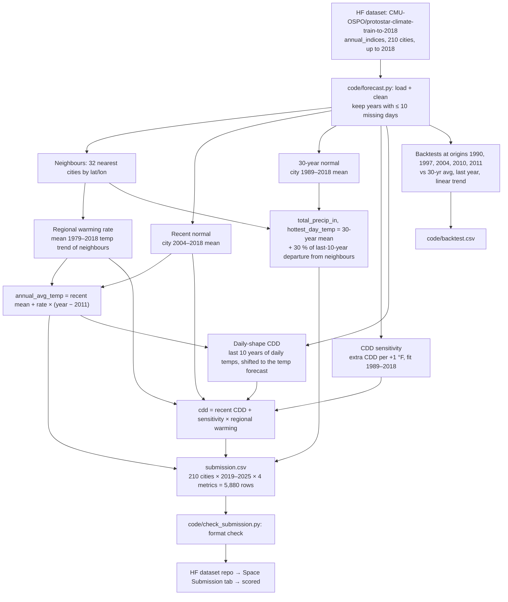

# Team Tatakae: Protostar Climate Challenge Submission

**Negative result:** no

**Hugging Face dataset (official submission):** [ironMan334/protostar-climate-team-tatakae](https://huggingface.co/datasets/ironMan334/protostar-climate-team-tatakae)

I forecast the yearly weather of 210 U.S. cities for 2019–2025. I only used data up to the end of 2018, so nothing in my inputs shows how 2019–2025 turned out. This is my entry for the [Protostar Challenge: Climate Risk Intelligence](https://huggingface.co/spaces/CMU-OSPO/protostar-challenge-climate-risk-intelligence).

## Team

I worked on this alone.

| Name | Hugging Face username | Program |
|---|---|---|
| Mashrafi Mahmud Rafi | [@ironMan334](https://huggingface.co/ironMan334) | CSE |

## Architecture

## Method

I call it **"recent normal + regional warming"**. It is a simple statistical forecast that anyone can follow. I picked it because it beat every bigger model I tried in my tests (below).

- **The model:**
  - **Average temperature:** I take the city's 2004–2018 average. Then I add the *regional* warming rate times the number of years since 2011 (the middle of that 15-year window). A 15-year window beat a 10-year one when replayed from every start year 1985–2011 (temperature skill 0.112 → 0.119, CDD 0.081 → 0.084). The regional warming rate is the average 1979–2018 temperature trend of the city's 32 closest cities. The middle value is +0.52 °F per decade (range +0.33 to +0.63).
  - **Cooling degree days (CDD):** I take the city's 2004–2018 average CDD. Then I add the city's *CDD sensitivity* times the same regional warming. CDD sensitivity means "how many extra CDD the city gets for each +1 °F of yearly temperature", fitted on 1989–2018. This makes sense because CDD comes from temperature, and the shared regional temperature trend is much less noisy than one city's own CDD trend.
  - **Second view, "region + departure" (75 % weight for temperature and CDD):** each year, a city's value = its region's anomaly (mean of its 32 nearest cities, each measured against its own 1989–2018 mean) + the city's *departure* from that region. The departure is much less noisy than the raw value, because weather shared across the region cancels out, so its last 5 years are enough to pin it down (this also follows station moves quickly). The region's anomaly is carried forward with a 1989–2018 trend line; CDD uses the same regional anomaly times the city's CDD sensitivity. The final forecast is 75 % this view + 25 % the first one. I chose this by replaying it from every start year 1985–2011 (data before that year only): on average it adds about +0.02 to temperature skill and +0.01 to CDD skill. It is not better in every window (see the table: 1997 got worse, 2004 better).
  - **Third view for CDD, "daily shape" (50 % weight):** CDD is not a straight line in temperature: only days above 65 °F count, so a warmer year adds more CDD in a hot city than in a cool one. For each of the city's last 10 valid years, I take that year's real daily temperatures, shift them so the year's average equals my temperature forecast, and recount CDD. The mean of those 10 counts is the third view; the final CDD is 50 % this + 50 % the first two. Replayed from every start year 1985–2011, it raised CDD skill from 0.0766 to 0.0811 and won in 70 % of start years.
  - **Rain and the hottest day:** the city's 1989–2018 average, with a small nudge. Each year I take the city's *departure* from its 31 nearest neighbours (each measured against its own 1989–2018 mean; for rain, as a ratio). If the last 10 years' departure is non-zero, something local changed, most often a station move, so I add **30 %** of it. A full 100 % would chase noise, and 30 % with 10 years was the steadiest setting: replayed from every start year 1985–2011, hottest-day skill went 0 → +0.005 (better in 93 % of start years, worst −0.001) and rain 0 → +0.003 (better in 70 %). One shared setting for both, so it is not tuned per metric.
- **Inputs:** only `annual_indices` and `daily` up to 2018, plus each station's latitude and longitude to find its neighbours. I only count a year if 10 or fewer days are missing. This is the same rule the challenge uses for scoring. I used no outside data.
- **How I tested it:** I ran the exact same method at five points in the past. Each time it could only see the years before that point. The score uses the challenge formula (compared with the 30-year average):

| Test years (start point) | Temp S | Precip S | Hot day S | CDD S | **Score: mine** | Score: linear trend |
|---|---:|---:|---:|---:|---:|---:|
| 1991–1997 (1990) | 0.065 | −0.001 | 0.005 | 0.042 | **2.8** | 0.0 |
| 1998–2004 (1997) | 0.161 | 0.000 | 0.001 | 0.026 | **4.7** | 0.0 |
| 2005–2011 (2004) | 0.191 | 0.005 | 0.012 | 0.149 | **8.9** | 0.0 |
| 2011–2018 (2010, organisers' practice run) | 0.161 | 0.003 | 0.003 | 0.223 | **9.8** | 4.8 |
| 2012–2018 (2011) | 0.153 | 0.000 | 0.005 | 0.225 | **9.6** | 2.2 |

The errors (MAE) for each metric and all four forecasts (mine, 30-year average, last year repeated, linear trend) are in `code/backtest.csv`. My model does better in later test windows, because warming speeds up over time. It beats the linear-trend baseline in every window.

  In the organisers' practice run (data up to 2010, forecast 2011–2018), I get the exact same reference numbers they give: the 30-year average has a CDD error of **212.6 °F-days** and the trend line **176.9**. My model gets **165.2**. That beats the trend line by more than the 10 °F-day tie margin (level 2). For temperature, my error is 1.39 °F, against 1.66 for the 30-year average and 1.43 for the trend line.

**What I learned (and why the model is so simple).** I tested more than 100 versions: recent 5/10/15/20-year averages, 30/40/50-year trends, medians (MAE rewards medians), one city alone vs. 4/8/16/32/210 neighbours, and a pooled Huber regression with all of these.
1. **Averaging over neighbours wins.** One city's trend is mostly noise from its station. The more cities I averaged, the better the forecast, up to about 32.
2. **The last 15 years beat the 30-year average for temperature and CDD**, because the climate has already moved away from the 1989–2018 average.
3. **Rain and the hottest day are mostly noise.** No version beat the 30-year average in every window. Some won one window and lost the next. So I kept the 30-year average there on purpose, instead of overfitting. The only thing that helped was a small station-move nudge (above): it does not try to predict the weather, it only corrects the city's level.

**Robustness check: every start year, not five.** Five test windows can flatter a model, so `code/origins.py` replays the exact same method from **every** start year 1985–2011 (27 runs, 7 years ahead each, data before the start year only):

| Start years | Temp S | Precip S | Hot day S | CDD S | **Score** |
|---|---:|---:|---:|---:|---:|
| All 27 (1985–2011) | 0.119 | 0.003 | 0.005 | 0.083 | **5.25** |
| Last 8 (2004–2011) | 0.112 | 0.004 | 0.005 | 0.171 | **7.28** |

The skill rises in later start years, as warming speeds up. My Live Score (2019–2021) is 14.3, above every backtest window. I read that as a warm stretch rewarding a warming-aware model, not as a sign the model is better than the backtests show.

**What did not work (all tested with the 27-start-year replay above, pre-2019 data only):**

Scores below are against the model before the rain / hottest-day nudge (5.05).

| Idea | Best score (vs 5.05) | Why I left it out |
|---|---:|---|
| Re-tune the blend weights and departure years (27-setting grid) | 5.14 | The best setting gains +0.0035 skill, but it is the top pick of 27, so it is within luck. I kept the old settings. |
| Rain / hottest day: 15- or 20-year mean, median, neighbour shrinkage | 4.79 | Every variant lost to the 30-year average (S down to −0.08). These two metrics are year-to-year noise. |
| Rain / hottest day: add the regional warming trend, or their own pooled 40/60-year trend | 4.96 | Hottest-day trends are weak and noisy, and rain trends do not persist. |
| Warming-rate multiplier 0.8–2.0 on temp and CDD | 5.07 | Flat: the "region + departure" view already follows the recent level. |
| Station-move fix from `coverage_and_stations`: shift earlier years so the city's departure from its neighbours stays the same across each station change | 5.09 | +0.04 is noise. Only 31 cities changed station after 1990, and the 5-year departure already follows moves. Not worth the extra code. |
| ENSO: next year's anomaly regressed on the Oct–Dec Niño 3.4 sea temperature (NOAA CPC, cut at 2018), pooled over neighbours | 5.08 | No gain for temp or CDD. Worse for rain and hottest day. |
| Pretrained time-series models (Chronos, TimesFM, Moirai) | not run | Their training sets include data from 2019 onward, or data of unknown dates, which the data rule forbids. They are also single-series models, so they cannot pool neighbours, which is where this model gets its skill. |

None of these entered the final forecast, so `submission.csv` uses only the challenge dataset.

**Why it is useful in real life.** The method only needs a station's own yearly record and its neighbours. It runs in seconds and has no hidden black box. It gives planners a clear "near-term normal" that anyone can rebuild for any GHCN station. In my tests it is a better planning number than the 30-year normals that power companies and building codes still use.

## Policy Idea

1. **What risk did I notice?** The need for air conditioning is growing fastest (in percent) in cities that were not built for heat. Across the 210 cities, CDD in 2009–2018 was already a median **16.6 % higher** than in 1959–1988. My forecast puts 2025 another **+13.0 %** above the 1989–2018 normal, with CDD going up in 98 % of cities. The biggest *percent* jumps are in the cool Northwest and the North: Seattle (+50 %), Salem (+42 %), Vancouver WA (+34 %), Reno (+28 %), Sault Ste. Marie (+40 %). Many homes there have no cooling, so a heat wave can become a health emergency (like the 2021 Pacific Northwest heat dome). Also, 13 cities have gone above 1,000 CDD a year since 1959–1988, including Columbus OH, Dayton, Boise, Asheville and Reno.
2. **What would I do, and who would do it?** A **"Cooling-Ready Cities" heat-pump program**, run by state energy offices together with power companies. Every year, a forecast like mine marks the cities where near-term CDD is expected to rise more than **+25 %** above the official 30-year normal, or to pass 1,000 CDD. In those cities, rebates would help low-income and elderly households swap old furnaces and window AC units for **cold-climate heat pumps**. The program would also add cool roofs and plant street trees on the hottest blocks. Power companies would use the forecast CDD, instead of old 30-year normals, to plan for summer peak demand.
3. **Why does it last?** A heat pump is both an efficient air conditioner and an efficient heater. It cuts winter heating emissions from gas and oil while adding cooling, so getting ready for heat lowers emissions instead of raising them. Cool roofs and trees lower cooling needs and cost nothing to run. A cheap, open forecast puts the money where the risk is really rising, before the emergency happens.

## Feedback to the Ecosystem

- **What got in my way:**
  - **Tools that are not browsers cannot see the challenge text.** The Space shows its rules with JavaScript, so a plain HTTP fetch (or an AI agent) only sees "Fetching metadata…". I had to read `content/about.md` and `content/data.md` from the Space's git repo to find the rules.
  - **The "valid year" rule is not clear enough for code.** "Years where the station missed more than 10 days" does not say which `Miss *` column goes with which metric (for example: Tmax and Tmin for average temperature and CDD, or only Tmax for the hottest day?). I had to guess. I only knew my guess was right because my 30-year-average and trend errors matched the organisers' numbers (213 and 177 °F-days).
  - **The 30-year-average baseline is not fully defined:** are invalid years included in the 1989–2018 average? Four cities (Huntsville, Grand Island, Elko, Hayward) have whole 30-year windows with no valid years at earlier start points.
  - **No station-change flags in `annual_indices`.** Each city's record joins several stations (listed in `city_info`), but no column shows the year a station moved. These moves cause sudden jumps that look like climate trends.
  - **Number precision changes in 2018** (one decimal from converted GHCN-D data, whole °F before). The data card mentions it, but the rows do not flag it.
  - **Two easy leaks in outside climate indices.** (1) NOAA's ONI table labels its last 2018 season "NDJ 2018", but it averages Nov 2018–**Jan 2019**, so a plain `year <= 2018` filter lets 2019 data in. (2) The published ONI *anomalies* are measured against a base period that moves every 5 years, and 2018 uses **1991–2020**, so even the 2018 anomaly carries information from 2019–2020. I kept only the raw sea temperature for Oct–Dec 2018 and computed my own anomaly from earlier years.
- **What would fix it:**
  - Add a line to the FAQ: for any external index, check the months each value covers and the base period of its anomaly, not just the year label.
  - Publish the rules as a plain Markdown file in the dataset or template repo, with a link from the Space.
  - Share the scorer (`score.py`) next to `check_submission.py`, with clear validity columns for each metric, for example a true/false `valid_<metric>` column in `annual_indices`.
  - Add a `station_id_in_use` column for each year, so people can find or fix station jumps.
  - Share the organisers' practice-run baseline numbers for every metric (not just CDD), so teams can check their whole pipeline.

## AI Tools and Agents

- **Claude Code (Anthropic, Claude model):**
  - Wrote and ran the backtest experiments: the "region + departure" view, the daily-shape CDD view, the 27-start-year replay (`code/origins.py`), the rain / hottest-day station-move nudge, and every idea in the "What did not work" table. Each replay used only data before its start year.
  - Added the methods that won to `code/forecast.py`, and updated this README.
  - Downloaded one outside file for an experiment: NOAA CPC's Niño 3.4 sea temperature, cut to Oct–Dec 2018 at download time, with no later values shown or saved. The test failed, so the file is not used and not included.
  - Used no 2019–2025 data, no live-leaderboard scores for choosing or tuning, and no numbers of its own as forecast inputs. Every value comes from `annual_indices` and `daily` up to 2018 through `code/forecast.py`.
  - It also checked pretrained forecasting models (Chronos, TimesFM, Moirai) against the data rule and left them out (see "What did not work").
- **Agent rules:** `code/CLAUDE.md` (the data rule, in four lines).
- **What I reviewed:** the code changes, the backtest numbers in the tables above, and that `python code/forecast.py` reproduces `submission.csv` without the agent.

## Files

| File | What it has |
|---|---|
| `submission.csv` | My forecasts: `city_id,year,metric,predicted_value` |
| `code/forecast.py` | The whole method: loads the data, runs the five backtests, writes `submission.csv` and `code/backtest.csv` |
| `code/origins.py` | Replays the method from every start year 1985–2011 and prints the skill and score |
| `code/backtest.csv` | Errors (MAE) of my model and the three reference baselines, for each metric and test window |
| `code/requirements.txt` | Python packages |
| `code/check_submission.py` | The template's format checker |

**Metric codes:** `annual_avg_temp` (°F), `total_precip_in` (inches), `hottest_day_temp` (°F), `cdd` (°F-days).
**City IDs:** the station `ID` from the `city_info` table of the training dataset (for example, Pittsburgh = `USW00094823`).

## How to Run It Yourself

1. `pip install -r code/requirements.txt` (Python 3.10 or newer).
2. `python code/forecast.py`. It downloads `annual_indices` and `daily` from the Hub, prints the backtests, and rewrites `submission.csv` and `code/backtest.csv`. It takes under a minute and gives the same output every time. Add `--data DIR` to use local copies of `annual_indices.parquet` and `daily.parquet` (e.g. `--data data`).
3. Optional: `python code/origins.py --data data` → the 27-start-year robustness table (about a minute).
4. `python code/check_submission.py` → `OK: submission.csv has all 5880 forecasts and can be scored.`

## Data

- **Outside data:** none. The forecasts use only the challenge dataset up to 2018-12-31. The policy section only uses numbers I computed from the same data.

Training data: [`CMU-OSPO/protostar-climate-train-to-2018`](https://huggingface.co/datasets/CMU-OSPO/protostar-climate-train-to-2018), from:

- Lai, Y., & Dzombak, D. A. (2019). Compiled historical daily temperature and precipitation data for selected 210 U.S. cities. Carnegie Mellon University. https://doi.org/10.1184/R1/7890488.v6
- Lai, Y., & Dzombak, D. A. (2019). Historical changes of annual temperature and precipitation indices at selected 210 U.S. cities. Carnegie Mellon University. https://doi.org/10.1184/R1/7961012.v6
- Lai, Y., & Dzombak, D. A. (2019). *Use of historical data to assess regional climate change.* Journal of Climate, 32(14), 4299–4320. https://doi.org/10.1175/JCLI-D-18-0630.1
